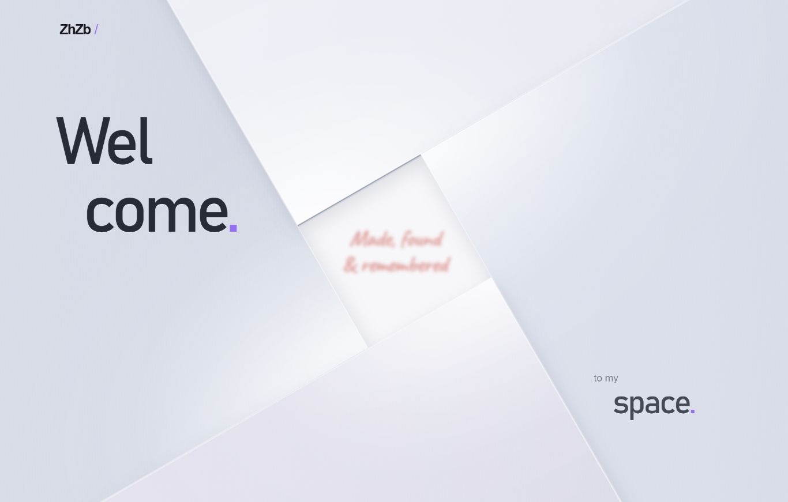

# 网页前端设计参考 · ZhZb

一套可直接运行的个人网站前端参考：描线开场、旋转叠片、珍珠银材质、毛玻璃交互、图标内容预览与圆形铺屏转场。

使用原生 **HTML / CSS / JavaScript**，无需构建依赖；支持手机和电脑，并附带 Crab Coast 浏览器小游戏与本地杂记功能。



[版本更新记录](CHANGELOG.md) · [本地运行](#本地预览) · [发布与回退](docs/development-and-release.md)

## 当前版本

当前代码版本：**v0.2.0 — 三赛道竞速版**。完整历史和每版说明见 [版本更新记录](CHANGELOG.md)。

- 描线开场、珍珠银薄板，以及 Wel / come. 与 to my / space. 的错位排版。

- 开场红字居中模糊显示，悬停后渐变为 Go!，同时扩大中央开口。

- 四块叠片逆时针旋转的欢迎页，中央方形进入按钮。
- 手写文案 Made, found & remembered。
- 十二个环绕图标：Journal 和 Crab Coast 可用，其余十个标注开发中。
- 悬停 Go! 切换两侧英文；探索图标时中央显示日记纸片、螃蟹骑行等内容预览。
- 点击入口，由图标位置展开圆形覆盖屏幕后跳转；手机首次点击预览，再次点击进入。
- 环绕动画支持暂停、键盘操作和减少动态效果偏好。
- Crab Coast 提供三条赛道、六位动物车手、排名计时、小地图和比赛中切换赛道。
- 游戏支持短漂出弯冲刺、尾流加速与碰撞减速；常规限速 72 km/h，漂移奖励最高 90 km/h。
- 手机采用方向轮盘与独立踏板，“漂移＋油门”支持一个拇指持续加速并漂移。
- 杂记支持本地记录、分类搜索、JSON 导入导出和主题切换。

**当前杂记记录保存在浏览器 localStorage，尚未实现云端同步或管理员登录。** 仓库及部署包不包含浏览器内的个人记录。迁移前先导出 JSON。

## 目录

- `dist/`：发布网站文件；部署时将其中内容作为网站根目录。
- `home-checks.cjs`：欢迎页、入场生命周期、暂停与恢复检查。
- `orbit-checks.cjs`：图标预览、触屏操作、圆形转场与返回清理检查。
- `checks.cjs`：游戏键盘与触摸控制检查。
- `race-*-checks.cjs`、`race-checks.cjs` 和 `race-regressions.cjs`：竞速、漂移、三赛道及碰撞检查。
- `physics-checks.cjs`：历史自由骑行物理检查，当前竞速页面不加载此模块。
- `docs/`：版本维护、发布和恢复说明。
- `CHANGELOG.md`：版本号、对应提交和中文更新说明。
- `.openai/hosting.json`：历史工具配置。当前正式发布目标是已有 EdgeOne 项目，不要据此误发布到另一个站点。

## 本地预览

在仓库目录运行：

```sh
python -m http.server 8779 --bind 127.0.0.1 --directory dist
```

主页：`http://127.0.0.1:8779/#home`

重播开场：`http://127.0.0.1:8779/?welcome=1`

## 检查

需要已安装 Node.js：

```sh
node --check dist/home.js
node --check dist/orbit.js
node --check dist/journal/app.js
node home-checks.cjs
node orbit-checks.cjs
node checks.cjs
node race-checks.cjs
node race-regressions.cjs
node race-courses-checks.cjs
node race-drift-checks.cjs
node race-arcade-checks.cjs
node race-map-checks.cjs
node physics-checks.cjs
```

## 发布

正式域名：https://www.zhzb.site/

仓库负责源代码与版本管理；推送 GitHub 当前不会自动更新正式网站。参见 [发布与版本管理](docs/development-and-release.md)。

## 游戏操作

电脑：W / S 加速或倒车，A / D 转向，空格漂移，Shift 刹车，J 跳跃，P 暂停，R 重赛。

手机：左侧轮盘控制方向，右侧加速与“漂移＋油门”交替操作，松开漂移结束滑行并在蓄力足够时获得冲刺；刹车和倒车可接管组合键的油门。上方“赛道”按钮用于暂停并切换赛道。

## 字体与图标

Caveat 来自 [Google Fonts](https://github.com/google/fonts/tree/main/ofl/caveat)，按 SIL OFL 1.1 提供，许可证保存在 `dist/assets/fonts/OFL-Caveat.txt`。图标为本项目内联 SVG。
